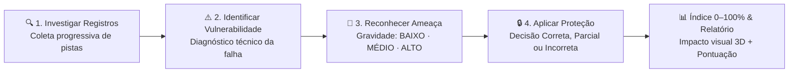

<div align="center">

# 🛡️ CYBER DEFENSE — Proteja sua Smart Home

### *Simulador Educativo 3D de Auditoria e Cibersegurança em Ambientes IoT*

<p>
  
  
  
  
  
  
</p>

<p>
  <strong>15 Ambientes 3D Exploráveis</strong> • <strong>33 Dispositivos IoT Auditáveis</strong> • <strong>Pontuação 0–1000 pts</strong> • <strong>Relatório Executivo PDF/TXT</strong>
</p>

[Sobre o Projeto](#-sobre-o-projeto) •
[Pilares Pedagógicos](#-pilares-pedagógicos) •
[Ambientes e Dispositivos](#-mapa-da-propriedade-15-ambientes-e-33-dispositivos) •
[Arquitetura Técnica 3D](#-engenharia-3d-e-otimização) •
[Controles e Atalhos](#-controles-e-atalhos) •
[Instalação e Execução](#-instalação-e-execução)

</div>

---

## 🎯 Sobre o Projeto

**CYBER DEFENSE — Proteja sua Smart Home** é um simulador educativo tridimensional interativo no qual o jogador assume o papel de **especialista em cibersegurança contratado para auditar uma residência inteligente completa**.

Construído com arquitetura contemporânea em **Three.js (WebGL)**, materiais **PBR (Physically Based Rendering)** e interface minimalista de alta legibilidade, o jogo desafia o auditor a explorar cada cômodo interno, garagem, áreas de lazer, jardim e rua pública para investigar dispositivos conectados, distinguir configurações seguras de vulnerabilidades reais e aplicar defesas eficazes antes de emitir o **Relatório Final de Auditoria**.

> [!TIP]
> **Simulação 100% segura e educativa:** Nenhuma rede Wi-Fi, câmera ou dispositivo externo real é acessado. Todo o tráfego, endereços IP, alertas e registros forenses operam em ambiente simulado local.

---

## 🧠 Pilares Pedagógicos

Toda a progressão do jogo foi estruturada em torno de **três competências obrigatórias de cibersegurança defensiva**:



| Etapa | O que o auditor faz | Impacto no sistema |
| :--- | :--- | :--- |
| **1. Identificar Vulnerabilidades** | Analisa credenciais padrão, portas abertas (`RTSP`, `HTTP`, `RDP`, `SMBv1`), `WPS/UPnP`, firmware vencido, permissões excessivas e protocolos sem TLS. | Revela o diagnóstico raiz e desbloqueia a análise de risco. |
| **2. Reconhecer Ameaças** | Classifica as consequências reais (espionagem, ransomware, botnets, clonagem de RF, fadiga de alertas, abertura física de acessos). | Registra o nível de gravidade (`BAIXO`, `MÉDIO` ou `ALTO`). |
| **3. Selecionar Medidas de Proteção** | Escolhe entre soluções **corretas**, **parciais** (com risco residual explicado) ou **incorretas** (com penalidade e feedback educativo). | Atualiza em tempo real os LEDs/anéis 3D, a barra de segurança (%) e a pontuação. |
| **4. Evitar Falsos Positivos** | **10 dispositivos já estão protegidos** (VLAN IoT, `WPA3`, `TLS 1.3`, `Zigbee AES-128`, `Matter/Thread`). O jogador deve validá-los corretamente. | Ensina auditoria realista sem marcar itens conformes como falhos. |

---

## ✨ Funcionalidades Principais

- 🏠 **Residência 3D Contemporânea Expandida**: Arquitetura detalhada com paredes com espessura real, rodapés, janelas envidraçadas, cortinas, iluminação arquitetônica, móveis compostos e texturas procedurais.
- 🗺️ **Mapa Arquitetônico Interativo (`M`)**: Planta 2D sincronizada em tempo real com os estados de segurança (`Não auditado`, `Vulnerável`, `Parcial`, `Investigado`), permitindo navegar diretamente para qualquer cômodo ou dispositivo.
- 🖱️ **Seleção Direta no Cenário 3D**: Raycasting em duas camadas — clique em **qualquer dispositivo IoT** para inspecioná-lo ou diretamente no **piso de qualquer cômodo** para reposicionar a câmera.
- 🌐 **Visualização de Rede IoT e Sobreposição de Status**: Alterne arcos de conexão partindo do roteador principal (`Rede IoT`) e indicadores visuais discretos (`Protegido` em verde, `Atenção` em âmbar, `Vulnerável` em vermelho).
- 🚗 **Rua Pública Viva & Ambiente Dinâmico**: Tráfego contínuo de 6 veículos em duas faixas com controle de distância segura, giro proporcional das rodas, faixa de pedestres, postes, vizinhança, piscina com ondulação na água e robô cortador patrulhando o gramado.
- 🤖 **CYBER ASSISTANT (IA + Base Local)**: Tutor pedagógico integrado via backend `/api/assistant` (Google Gemini `gemini-4-hydrogen`) com fallback automático offline — **nunca entrega a resposta pronta**, oferecendo apenas pistas progressivas contextualizadas.
- 📈 **Central de Monitoramento de Segurança**: Painel executivo com medidor circular de proteção (%), KPIs por status, gráfico de segurança por ambiente e fila de alertas priorizada por gravidade.
- 🔊 **Áudio Procedural Web Audio API**: Efeitos sonoros leves de seleção, varredura, sucesso, alerta e som ambiente discreto ao observar a rua (sem arquivos externos de áudio).
- 📄 **Relatório Final & Exportação**: Classificação de desempenho (`0–1000 pts`), auditoria de vulnerabilidades corrigidas vs. pendentes, histórico completo de decisões, download em `.txt` e impressão formatada em PDF.

---

## 🗺️ Mapa da Propriedade: 15 Ambientes e 33 Dispositivos

A propriedade é dividida em **3 grandes zonas**, somando **15 ambientes** e **33 dispositivos IoT** calibrados para totalizar exatamente **1.000 pontos** em uma auditoria perfeita (**23 desafios vulneráveis** + **10 equipamentos seguros de referência**).

<details>
<summary><strong>🛋️ Interiores da Casa (8 ambientes · 20 dispositivos)</strong> — clique para expandir</summary>

| Ambiente | Dispositivos | Pontos | Foco Pedagógico |
| :--- | :--- | :---: | :--- |
| **Sala de Estar** | Câmera Inteligente da Sala, Roteador Wi-Fi Principal, Smart Speaker, Smart TV 4K *(Seguro)* | `155` | Senha padrão, `WPA/TKIP`, `WPS/UPnP`, segmentação IoT, menor privilégio e validação de TV em VLAN. |
| **Hall & Corredor** | Campainha Inteligente com Vídeo, Central de Alarme Conectada | `90` | Privacidade de gravações em nuvem, links públicos, ausência de `2FA` e TLS em painel de alarme. |
| **Quarto Principal** | Iluminação Inteligente, Termostato Inteligente, Assistente de Cabeceira *(Seguro)* | `95` | Firmware desatualizado, painel `HTTP` sem criptografia e validação de dispositivo com `MFA` + `TLS 1.3`. |
| **Cozinha** | Geladeira Inteligente, Detector de Monóxido e Gás, Sensor de Fumaça *(Seguro)* | `70` | Exposição de dados/apps terceiros, manutenção/bateria crítica e criptografia `Zigbee AES-128`. |
| **Sala de Jantar** | Iluminação Inteligente Pendente, Sensor de Presença *(Seguro)* | `40` | Pareamento `Zigbee Permit-Join` aberto com chave de fábrica e processamento local `Matter/Thread`. |
| **Escritório** | Estação de Trabalho Dual-Monitor, Impressora Wi-Fi *(Seguro)* | `55` | Patches críticos pendentes, `RDP 3389`, `SMBv1`, firewall desativado e impressão segura `IPPS`. |
| **Banheiro** | Sensor de Vazamento de Água, Sensor de Umidade e Ventilação *(Seguro)* | `45` | Token expirado, alertas ausentes, modo AP aberto e automação local segura. |
| **Quarto Adicional** | Ar-Condicionado Inteligente, Smart TV Hóspedes *(Seguro)* | `45` | Hotspot Wi-Fi de manutenção aberto, firmware antigo e rede isolada de visitantes. |

</details>

<details>
<summary><strong>🚗 Serviços & Garagem (2 ambientes · 4 dispositivos)</strong> — clique para expandir</summary>

| Ambiente | Dispositivos | Pontos | Foco Pedagógico |
| :--- | :--- | :---: | :--- |
| **Lavanderia** | Tomada Inteligente, Lavadora e Secadora *(Seguro)* | `45` | API HTTP local sem autenticação, excesso de integrações terceiras e menor privilégio. |
| **Garagem** | Portão Eletrônico Inteligente, Carregador de Veículo Elétrico (`Wallbox`) | `80` | Clonagem de sinal RF de código fixo (vs. *rolling code*), `MFA` no app e protocolo `OCPP` sem `TLS` (`ws://` vs `wss://`). |

</details>

<details>
<summary><strong>🌳 Área Externa, Lazer & Rua Pública (5 ambientes · 9 dispositivos)</strong> — clique para expandir</summary>

| Ambiente | Dispositivos | Pontos | Foco Pedagógico |
| :--- | :--- | :---: | :--- |
| **Terraço Frontal** | Fechadura Inteligente, Sensor de Movimento, Câmera PoE *(Seguro)* | `105` | PIN fraco (`0000`), falta de bloqueio por tentativas, RF sem código rolante e validação `RTSPS`. |
| **Área Gourmet** | Sistema de Som Bluetooth | `30` | Pareamento Bluetooth aberto sem PIN em área alcançável do exterior. |
| **Piscina & Deck** | Controlador Inteligente da Piscina | `40` | Painel web em `HTTP` sem criptografia, senha padrão e exposição remota. |
| **Quintal & Jardim** | Sistema de Irrigação Automática, Cortador Robô de Grama, Estação Meteorológica *(Seguro)* | `55` | Tokens OAuth amplos sem limite operacional, BLE sem PIN/antifurto e telemetria read-only segura. |
| **Rua Pública** | Câmera Externa Voltada para a Rua | `50` | Stream `RTSP` aberto via `UPnP` na internet pública, credenciais padrão e máscara de privacidade. |

</details>

---

## ⚙️ Engenharia 3D e Otimização

O motor gráfico foi projetado para rodar com fluidez em navegadores modernos mantendo fidelidade arquitetônica e baixíssimo overhead de GPU/CPU:

- **Materiais PBR & Texturas Procedurais (`src/three/proceduralTextures.ts`)**: Geração via `CanvasTexture` com gerenciamento correto de espaço de cor (`SRGBColorSpace` / `NoColorSpace`), filtragem anisotrópica e descarte completo no unmount (`textures.dispose()`). Inclui piso de madeira, mármore, tecidos com `normalMap`, pastilhas de piscina, superfície de água animada, asfalto, calçada, grama e telas de TV/geladeira/monitores.
- **Instanciação e LOD (`src/three/exteriorAndStreet.ts`)**: Arbustos ornamentais, pedras de caminho do jardim e faixas de pedestres renderizados via `THREE.InstancedMesh` com `computeBoundingSphere()`, além de árvores externas com `THREE.LOD`.
- **Loop Zero-GC & Tráfego Contínuo**: Atualização de câmera exponencial (`MathUtils.damp`), animação da água, patrulha do robô cortador e simulação de 6 veículos com alocação zero por frame.
- **Adaptabilidade Automática & Tiers Gráficos**: Detecção automática de renderizadores WebGL por software (`SwiftShader` / `llvmpipe`) com uso de `afterDraw` (`gl.fenceSync`) + seletor manual de qualidade (`BAIXA`, `MÉDIA`, `ALTA`) e suporte a **Redução de Animações**.

---

## 🕹️ Controles e Atalhos

| Ação / Tecla | Função |
| :--- | :--- |
| **Botão Esquerdo (arrastar)** | Orbitar câmera 3D ao redor da propriedade |
| **Botão Direito (arrastar)** | Mover (pan) o foco pelo terreno, interiores e rua |
| **Scroll do Mouse** | Zoom aproximado ou visão panorâmica |
| **Clique em Dispositivo 3D** | Seleciona o aparelho e abre o painel forense de investigação |
| **Clique no Piso do Cômodo** | Move suavemente a câmera 3D para o ambiente clicado |
| **`M`** | Abre/fecha o **Mapa Arquitetônico Interativo** |
| **`R` ou `0`** | Restaura a câmera para a **Visão Geral da Propriedade** |
| **`1` a `8`** | Foca rapidamente ambientes-chave *(Sala, Quarto, Cozinha, Terraço, Escritório, Garagem, Piscina, Rua)* |

---

## 🏆 Sistema de Pontuação e Classificação

| Faixa de Pontos | Classificação Final |
| :---: | :--- |
| `0 – 299 pts` | 🔴 **Segurança crítica** |
| `300 – 499 pts` | 🟠 **Segurança vulnerável** |
| `500 – 699 pts` | 🟡 **Segurança moderada** |
| `700 – 849 pts` | 🔵 **Segurança avançada** |
| `850 – 1000 pts` | 🟢 **Residência altamente protegida** |

- O progresso é salvo automaticamente no navegador (`localStorage` sob a chave `cyber_defense_smarthome_v1`) com *merge* seguro de estado para novos dispositivos.

---

## 🛠️ Stack Tecnológica e Estrutura do Projeto

### Tecnologias Utilizadas
- **Frontend:** React 19, TypeScript, Vite 8, Tailwind CSS v4, Lucide React, Motion
- **Motor 3D:** Three.js (`OrbitControls`, `RoomEnvironment`, `PMREMGenerator`, `InstancedMesh`, `LOD`)
- **Estado Global:** Zustand (`persist`)
- **Backend & IA:** Express 4 (`tsx`), Dotenv, `@google/genai` (Gemini API via rota `/api/assistant`)

### Estrutura de Diretórios

```text
├── server.ts                         # Servidor Express + Vite middleware + rota /api/assistant (Gemini)
├── metadata.json                     # Metadados e capacidades da aplicação
├── .env.example                      # Variáveis de ambiente (GEMINI_API_KEY, APP_URL)
├── index.html                        # Entry HTML e meta tags OpenGraph
└── src/
    ├── App.tsx                       # Orquestração de telas (Início, Simulador 3D, Relatório) e modais
    ├── types/game.ts                 # Tipagens estritas (15 RoomIds, 31 DeviceKinds, desafios e estado)
    ├── store/useGameStore.ts         # Store Zustand com lógica de investigação, pontuação e segurança %
    ├── data/
    │   ├── smartHomeData.ts          # Catálogo completo dos 15 ambientes, 33 dispositivos e 1000 pts
    │   ├── tutorialData.ts           # Roteiro guiado de 7 passos
    │   └── assistantKnowledge.ts     # Base pedagógica local de fallback para o Cyber Assistant
    ├── three/
    │   ├── proceduralTextures.ts     # Gerador de texturas PBR procedurais em Canvas
    │   ├── houseArchitecture.ts      # Arquitetura e mobiliário dos cômodos internos e garagem
    │   ├── exteriorAndStreet.ts      # Quintal, área gourmet, piscina, vizinhança, rua e tráfego 3D
    │   └── iotDeviceModels.ts        # Modelagem 3D composta para todos os dispositivos IoT
    ├── utils/sound.ts                # Motor de áudio procedural Web Audio API
    └── components/
        ├── SmartHomeCanvas.tsx       # Viewport WebGL, iluminação, raycasting, câmera e qualidade gráfica
        ├── PropertyMapModal.tsx      # Mapa arquitetônico 2D interativo sincronizado em tempo real
        ├── LeftNavigator.tsx         # Navegador por zonas, aparelhos, alertas e missões
        ├── DeviceInvestigationPanel.tsx # Fluxo forense passo a passo por dispositivo
        ├── SecurityCenterModal.tsx   # Dashboard de métricas, gráfico por cômodo e alertas
        ├── CyberAssistantModal.tsx   # Tutor educativo conectado ao Gemini / base local
        ├── TopHudBar.tsx             # Barra superior com cronômetro, segurança % e pontuação
        ├── BottomCameraDock.tsx      # Seletor de ambientes, Mapa, Rede IoT, Indicadores e Foco 3D
        ├── FinalReportView.tsx       # Relatório executivo final com exportação PDF/TXT
        ├── StartScreen.tsx           # Tela inicial com visão dos pilares pedagógicos
        ├── TutorialBanner.tsx        # Guia interativo na tela
        ├── InfoModals.tsx            # Modais de Como Jogar, Configurações e Confirmação
        └── DeviceIcon.tsx            # Mapeamento de ícones Lucide para cada categoria IoT
```

---

## 🚀 Instalação e Execução

### Pré-requisitos
- **Node.js** `>= 20`
- **npm**

### 1. Instalar dependências
```bash
npm install
```

### 2. Configurar variáveis de ambiente *(opcional para o Tutor IA)*
Copie `.env.example` para `.env` e informe sua chave caso queira habilitar respostas dinâmicas via Gemini no **CYBER ASSISTANT** (sem a chave, o assistente opera perfeitamente utilizando a base educativa local):
```env
GEMINI_API_KEY="SUA_CHAVE_GEMINI_AQUI"
APP_URL="http://localhost:3000"
```

### 3. Executar em modo de desenvolvimento
```bash
npm run dev
```
Acesse **`http://localhost:3000`** no navegador.

### 4. Verificação de tipos e build de produção
```bash
npm run lint    # Executa tsc --noEmit
npm run build   # Gera bundle de produção em dist/
npm run start   # Inicia servidor Express em produção na porta 3000
```

---

<div align="center">

Feito para ensinar **Cibersegurança Defensiva e IoT** na prática — **CYBER DEFENSE: Proteja sua Smart Home** 🛡️

</div>
